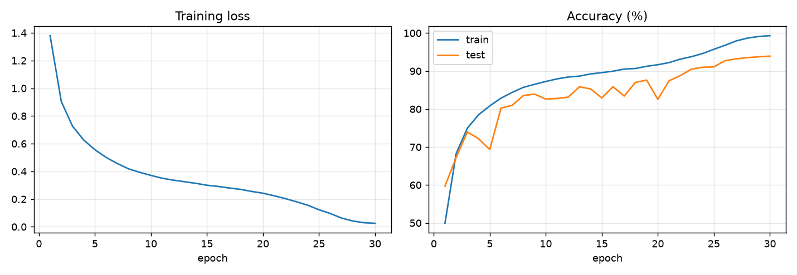
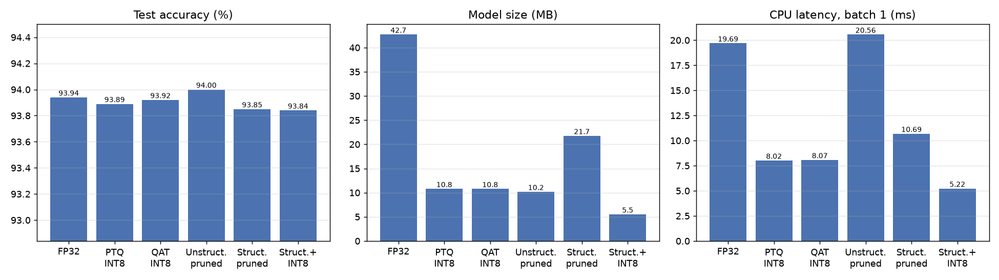
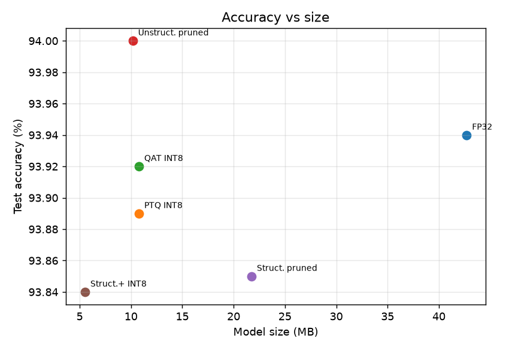
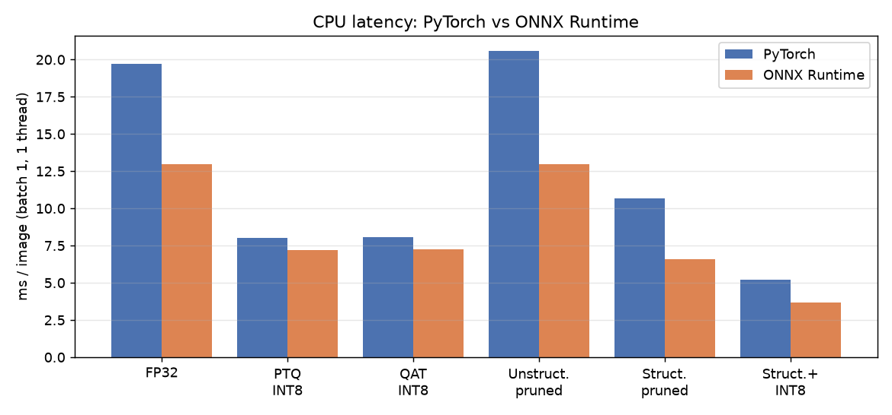

# Assignment 3 - Edge Computing & Intelligent Systems

## Model Optimization: Quantization (PTQ, QAT) and Pruning (Unstructured, Structured) of ResNet-18 on CIFAR-10

Name: Syed M. Alyun  Roll No: 23I-0022  Section: AI-A7  

## 1. Environment

- Python 3.11.15, PyTorch 2.7.1+cu118, OS: Linux x86_64
- Training device: CUDA GPU; all benchmarks run on CPU (1 thread, to resemble an edge device and keep the comparison fair)
- Benchmark CPU: Intel(R) Core(TM) i7-7700HQ CPU @ 2.80GHz
- Quantization backend: x86 (FBGEMM / oneDNN kernels), INT8 weights and activations

## 2. Baseline FP32 model

**Architecture.** ResNet-18 adapted for 32x32 inputs: the first layer is a 3x3 conv with stride 1 and the max-pool is removed (the ImageNet 7x7/stride-2 stem would shrink a 32x32 image to 8x8 too early). Four stages of two BasicBlocks with 64/128/256/512 channels, global average pooling and a 10-way linear layer (11.2 M parameters).

To make the same network quantizable in eager mode it contains a `QuantStub` / `DeQuantStub` at input/output, a separate `nn.ReLU` module for every activation (so it can be fused), and the residual addition is done with `nn.quantized.FloatFunctional` so the add itself gets an observer and an INT8 kernel.

**Training.** SGD (momentum 0.9, Nesterov, weight decay 5e-4), One-Cycle learning-rate schedule (max LR 0.1), batch size 128, augmentation: random crop with 4-pixel padding + horizontal flip, normalisation with CIFAR-10 mean/std. 30 epochs, and the weights after the final epoch are saved to `models/fp32_resnet18.pth`.

**Model selection.** No checkpoint is selected using the test set in any script: every training / fine-tuning run uses a fixed schedule and keeps the final weights. Test accuracy is printed per epoch only to monitor progress, so the reported test accuracies remain unbiased estimates.

Result: test accuracy **93.94%** after 30 epochs.



## 3. Post-Training Static Quantization (PTQ) - `src/ptq.py`, `src/calibration.py`

1. **Fusion** - `Conv+BN+ReLU` and `Conv+BN` groups (stem, every block, every 1x1 shortcut) are fused with `torch.ao.quantization.fuse_modules`. BatchNorm is folded into the conv weights/bias, which removes layers and avoids quantization error between conv and BN.
2. **Backend / qconfig** - `torch.backends.quantized.engine = 'x86'` and `get_default_qconfig('x86')`: weights per-channel symmetric INT8 (`PerChannelMinMaxObserver`), activations per-tensor affine UINT8 with a `HistogramObserver` (chooses the clipping range that minimises quantization error instead of using raw min/max).
3. **Prepare** - `prepare()` inserts observers after every quantizable op.
4. **Calibration** - 2000 randomly chosen *training* images (no augmentation, fixed seed) are passed through the observed model in eval mode; the observers record activation ranges. The test set is never used for calibration.
5. **Convert** - `convert()` replaces modules with INT8 kernels (`QuantizedConvReLU2d`, `QuantizedLinear`, `QFunctional` add) using the computed scale / zero-point.
6. **Save / deploy** - the INT8 model is traced and frozen to TorchScript (`models/ptq_int8_resnet18.pt`), so inference only needs `torch.jit.load()`; the script reloads the file and re-checks accuracy.

Result: PTQ INT8 accuracy **93.89%** vs FP32 93.94%.


## 4. Quantization-Aware Training (QAT) - `src/qat.py`

1. **Initialisation** from the trained FP32 checkpoint (not from scratch).
2. **QAT fusion** with `fuse_modules_qat` (model in train mode): produces `ConvBnReLU2d` modules that keep BatchNorm trainable while simulating the folded weights.
3. **Fake quantization** - `get_default_qat_qconfig('x86')` + `prepare_qat()` inserts `FakeQuantize` modules on weights and activations. In the forward pass values are quantized and immediately de-quantized, so the network *sees* INT8 rounding error; in the backward pass the straight-through estimator lets gradients flow.
4. **Fine-tuning** - SGD, LR 1e-3 with cosine decay. BatchNorm statistics are frozen at 60% of the epochs and the observers (scale/zero-point) at 80%, so the last epochs train against fixed quantization parameters. After every epoch the model is converted to a real INT8 model and evaluated (monitoring only); the weights after the final epoch are used.
5. **Convert + export** - `convert()` to INT8 and saved as TorchScript (`models/qat_int8_resnet18.pt`).

| QAT epoch | loss | train acc (fake-quant) % | test acc INT8 % |
|---|---|---|---|
| 1 | 0.0266 | 99.26 | 93.82 |
| 2 | 0.0245 | 99.33 | 93.99 |
| 3 | 0.0244 | 99.32 | 93.98 |
| 4 | 0.0179 | 99.54 | 93.98 |
| 5 | 0.0158 | 99.59 | 93.92 |

## 5. Unstructured pruning - `src/prune_unstructured.py`

- **Criterion:** global L1 magnitude pruning (`prune.global_unstructured` with `L1Unstructured`) over the weights of all 20 Conv layers and the FC layer. A global threshold lets layers with many redundant weights be pruned more than sensitive ones.
- **Iterative schedule:** the target sparsity (80%) is reached over N iterations. Each iteration removes the same fraction `a` of the *remaining* weights, with `(1-a)^N = 1 - target`, then fine-tunes. Gradual pruning lets the network adapt between steps and recovers more accuracy than pruning 80% in one shot.
- **Masking:** PyTorch keeps `weight_orig` and a binary `weight_mask` buffer; the forward uses `weight_orig * weight_mask`, so pruned weights stay zero during fine-tuning.
- **Permanent:** `prune.remove()` writes the masked weight back and deletes the mask/orig tensors.
- **Compressed checkpoint:** a dense tensor with 80% zeros is still the same size on disk, so the pruned weights are stored as a 1-bit packed mask + the non-zero values (`*_sparse.pth`). The loader rebuilds the dense tensors.

| iteration | sparsity % | acc right after pruning % | acc after fine-tune % |
|---|---|---|---|
| 1 | 33.13 | 93.89 | 93.98 |
| 2 | 55.28 | 93.56 | 94.03 |
| 3 | 70.09 | 91.63 | 94.05 |
| 4 | 80.00 | 88.66 | 94.00 |

Per-layer sparsity after pruning (`results/unstructured_layer_sparsity.csv`). The single global threshold prunes the large, redundant layers much harder than the small, sensitive first conv and the classifier:

| layer | weights | sparsity_% |
|---|---|---|
| conv1 | 1728 | 6.66 |
| layer1.0.conv1 | 36,864 | 32.19 |
| layer1.0.conv2 | 36,864 | 26.94 |
| layer1.1.conv1 | 36,864 | 26.66 |
| layer1.1.conv2 | 36,864 | 27.34 |
| layer2.0.conv1 | 73,728 | 29.42 |
| layer2.0.conv2 | 147,456 | 31.93 |
| layer2.0.shortcut.0 | 8192 | 15.97 |
| layer2.1.conv1 | 147,456 | 33.64 |
| layer2.1.conv2 | 147,456 | 36.98 |
| layer3.0.conv1 | 294,912 | 37.56 |
| layer3.0.conv2 | 589,824 | 42.59 |
| layer3.0.shortcut.0 | 32,768 | 22.52 |
| layer3.1.conv1 | 589,824 | 45.15 |
| layer3.1.conv2 | 589,824 | 57.32 |
| layer4.0.conv1 | 1,179,648 | 73.00 |
| layer4.0.conv2 | 2,359,296 | 93.37 |
| layer4.0.shortcut.0 | 131,072 | 51.26 |
| layer4.1.conv1 | 2,359,296 | 96.03 |
| layer4.1.conv2 | 2,359,296 | 99.38 |
| fc | 5120 | 4.16 |

## 6. Structured channel pruning - `src/prune_structured.py`

- **What is pruned:** the intermediate channels of each BasicBlock (output of `conv1`, `bn1`, input of `conv2`).
- **Keeping dimensions valid:** the output channels of a block are tied together by the residual addition (`out + shortcut(x)`), so they must match the shortcut and the neighbouring blocks. The middle channels are only connected to three tensors, so for the kept indices `k` the script slices `conv1.weight[k]`, `bn1.{weight,bias,running_mean,running_var}[k]` and `conv2.weight[:, k]` consistently.
- **Importance:** `score(c) = ||W_conv1[c]||_1 * |gamma_bn1[c]|` - the L1 norm of the filter times its BatchNorm scale; the lowest-scoring 50% of channels in every block are removed.
- **Reconstruction:** a new `ResNet18(channel_cfg=[...])` with physically smaller Conv/BN layers is built and the surviving weights are copied in. No masks or zero channels remain, so the model is faster with normal dense kernels. The checkpoint stores `channel_cfg` so the architecture can be rebuilt at load time.
- **Fine-tuning:** SGD with One-Cycle LR (max 0.02), 10 epochs, final weights kept.

| block | mid channels before | after |
|---|---|---|
| layer1.0 | 64 | 32 |
| layer1.1 | 64 | 32 |
| layer2.0 | 128 | 64 |
| layer2.1 | 128 | 64 |
| layer3.0 | 256 | 128 |
| layer3.1 | 256 | 128 |
| layer4.0 | 512 | 256 |
| layer4.1 | 512 | 256 |

- `Original: acc 93.94%  params 11,173,962  MACs 555.4M`
- `Pruned (before fine-tune): acc 38.21%  params 5,679,306 (50.8%)  MACs 281.7M (50.7%)`
- `Pruned (after fine-tune): acc 93.85%`

**Bonus - pruning + quantization combined.** The structured-pruned model is a normal dense network, so the same PTQ pipeline (`src/ptq.py --input models/structured_pruned_resnet18.pth`) quantizes it to INT8 (`models/structured_pruned_ptq_int8_resnet18.pt`): 93.84% accuracy, 5.52 MB (7.7x smaller than FP32), 5.22 ms per image (3.77x faster).

## 7. ONNX deployment - `src/export_onnx.py`, `src/onnx_infer.py`

- FP32, unstructured and structured models: `torch.onnx.export` (opset 17, dynamic batch).
- PTQ INT8: PyTorch's converted INT8 modules cannot be exported to ONNX directly, so the FP32 ONNX graph is statically quantized with ONNX Runtime (`quantize_static`, QDQ format, per-channel INT8 weights, UINT8 activations) using the same 2000 calibration images. Before quantization the graph goes through ORT's `quant_pre_process` (shape inference + graph optimization).
- Activation calibration method: **percentile**. ORT's default MinMax uses the raw min/max of each activation, so a few outliers stretch the scale and waste INT8 levels; Percentile (99.999%) and Entropy clip outliers, which is closer to PyTorch's `HistogramObserver`. Calibration runs in chunks of 100 images (`CalibStridedMinMax`) so the histogram methods do not keep every activation in memory.
- QAT INT8: exporting the fake-quant QAT graph directly keeps BatchNorm unfolded (the QAT ConvBn modules compute conv -> rescale -> BN), so ONNX Runtime cannot map it to INT8 conv kernels and the file keeps FP32 weights. Instead, the converted QAT INT8 weights and biases are de-quantized into a BN-folded float copy of the network (identical values, already on the INT8 grid) and that graph is statically quantized by ONNX Runtime. The weights quantize back onto the same grid; activation ranges are re-calibrated on the same 2000 images.
- Bonus: the structured-pruned ONNX graph is quantized the same way (`structured_ptq_resnet18.onnx`).
- All models are run with the ONNX Runtime CPU execution provider.

## 8. Benchmark results (CPU, full 10,000-image CIFAR-10 test set) - `src/benchmark.py`

### 8.1 Quantization (Q1)

| model | precision | accuracy_% | acc_change_pts | size_mb | compression_x | latency_b1_ms | speedup_b1_x | throughput_img_s |
|---|---|---|---|---|---|---|---|---|
| FP32 baseline | FP32 | 93.94 | 0.00 | 42.70 | 1.00 | 19.69 | 1.00 | 63.60 |
| PTQ INT8 | INT8 | 93.89 | -0.05 | 10.77 | 3.96 | 8.02 | 2.46 | 122.18 |
| QAT INT8 | INT8 | 93.92 | -0.02 | 10.77 | 3.96 | 8.07 | 2.44 | 127.60 |

### 8.2 Pruning (Q2)

| model | precision | accuracy_% | acc_change_pts | size_mb | compression_x | latency_b1_ms | speedup_b1_x | throughput_img_s | sparsity_% | nonzero_params | macs_M |
|---|---|---|---|---|---|---|---|---|---|---|---|
| FP32 baseline | FP32 | 93.94 | 0.00 | 42.70 | 1.00 | 19.69 | 1.00 | 63.60 | 0.00 | 11,173,962 | 555.42 |
| Unstructured pruned | FP32 | 94.00 | 0.06 | 10.17 | 4.20 | 20.56 | 0.96 | 62.76 | 79.93 | 2,242,480 | 555.42 |
| Structured pruned | FP32 | 93.85 | -0.09 | 21.74 | 1.96 | 10.69 | 1.84 | 116.82 | 0.00 | 5,679,306 | 281.74 |
| Structured pruned + PTQ INT8 (bonus) | INT8 | 93.84 | -0.10 | 5.52 | 7.74 | 5.22 | 3.77 | 215.45 | 0.00 | 5,679,306 | 281.74 |

Size of the unstructured model is the compressed (bitmask) checkpoint. Sparsity / MACs of the INT8 bonus model refer to its (structured-pruned) architecture.

### 8.3 ONNX Runtime

| model | precision | accuracy_% | size_mb | latency_b1_ms | speedup_b1_x | throughput_img_s |
|---|---|---|---|---|---|---|
| FP32 baseline | FP32 | 93.94 | 42.62 | 12.99 | 1.00 | 78.40 |
| PTQ INT8 | INT8 | 93.43 | 10.77 | 7.19 | 1.81 | 153.69 |
| QAT INT8 | INT8 | 93.53 | 10.77 | 7.23 | 1.80 | 153.85 |
| Unstructured pruned | FP32 | 94.00 | 42.62 | 12.95 | 1.00 | 83.25 |
| Structured pruned | FP32 | 93.85 | 21.66 | 6.59 | 1.97 | 169.19 |
| Structured pruned + PTQ INT8 (bonus) | INT8 | 93.08 | 5.51 | 3.68 | 3.53 | 290.43 |

### 8.4 Per-class accuracy (%)

| class | fp32 | ptq | qat | unstructured | structured | structured_ptq |
|---|---|---|---|---|---|---|
| airplane | 94.00 | 93.70 | 94.30 | 94.50 | 94.30 | 94.50 |
| automobile | 97.50 | 97.70 | 97.70 | 97.60 | 97.50 | 97.40 |
| bird | 91.30 | 91.50 | 91.70 | 90.80 | 92.40 | 92.30 |
| cat | 88.00 | 87.90 | 88.10 | 86.80 | 86.40 | 86.60 |
| deer | 95.20 | 95.20 | 95.50 | 95.20 | 95.40 | 95.40 |
| dog | 89.40 | 89.40 | 89.30 | 91.50 | 89.90 | 89.80 |
| frog | 95.90 | 96.10 | 96.20 | 96.30 | 95.80 | 96.00 |
| horse | 96.10 | 95.80 | 95.70 | 95.70 | 96.00 | 95.70 |
| ship | 96.60 | 96.60 | 95.80 | 96.20 | 95.70 | 95.80 |
| truck | 95.40 | 95.00 | 94.90 | 95.40 | 95.10 | 94.90 |

### 8.5 Are the accuracy differences significant?

All models are evaluated on the same 10,000 images, so they can be compared image by image. The table counts images where the baseline is right and the model is wrong (n01) and the opposite (n10), plus prediction agreement with FP32. McNemar's test (chi-square, continuity correction) gives the p-value for "same accuracy as FP32"; p > 0.05 means the difference is within noise.

| model | accuracy_% | agreement_with_fp32_% | n01 | n10 | p_value | significant |
|---|---|---|---|---|---|---|
| PyTorch ptq | 93.890 | 99.400 | 29 | 24 | 0.583 | no |
| PyTorch qat | 93.920 | 98.820 | 52 | 50 | 0.921 | no |
| PyTorch unstructured | 94.000 | 97.160 | 119 | 125 | 0.749 | no |
| PyTorch structured | 93.850 | 95.920 | 180 | 171 | 0.669 | no |
| PyTorch structured_ptq | 93.840 | 95.820 | 183 | 173 | 0.633 | no |
| ONNX fp32 | 93.940 | 100.000 | 0 | 0 | 1.000 | no |
| ONNX ptq | 93.430 | 97.850 | 121 | 70 | 0.000 | yes |
| ONNX qat | 93.530 | 97.620 | 127 | 86 | 0.006 | yes |
| ONNX unstructured | 94.000 | 97.160 | 119 | 125 | 0.749 | no |
| ONNX structured | 93.850 | 95.920 | 180 | 171 | 0.669 | no |
| ONNX structured_ptq | 93.080 | 94.760 | 270 | 184 | 0.000 | yes |







## 9. Discussion

- **PTQ vs QAT.** PTQ changed accuracy by -0.05 points and QAT by -0.02 points relative to FP32 (93.94%). Both models are 4.0x smaller (32-bit -> 8-bit weights) and run 2.46x / 2.44x faster at batch 1. McNemar's test (8.5) shows neither difference from FP32 is statistically significant, so both INT8 models should be read as matching FP32 accuracy rather than QAT being 'better'. ResNet-18 with per-channel weights and histogram calibration quantizes very well, which leaves PTQ little to lose; QAT pays off more on compact models (e.g. MobileNet) or at lower bit-widths (4-bit). PTQ takes seconds and needs only unlabeled calibration data; QAT needs labeled data and extra GPU training.
- **Unstructured pruning** removed 79.9% of the weights with a +0.06 point accuracy change and a 4.2x smaller (compressed) checkpoint, but latency changed only 0.96x: the zeros are still multiplied by dense conv kernels. Speed-ups need sparse kernels or hardware support (e.g. 2:4 sparsity on NVIDIA Ampere).
- **Structured pruning** kept a normal dense network with 282M MACs instead of 555M, giving a real 1.84x CPU speed-up and 2.0x smaller file, at -0.09 points. Removing whole channels is coarser than removing single weights, so it usually costs more accuracy for the same parameter reduction, but it is the approach that helps on ordinary edge CPUs.
- **Combining methods.** Structured pruning + INT8 gave the smallest and fastest model: 5.52 MB and 3.77x faster than FP32 at -0.10 points, because the two methods remove different redundancy (fewer channels vs fewer bits per value).
- **ONNX Runtime.** The FP32 ONNX model gives identical predictions to PyTorch and runs 1.52x faster (graph optimizations, fused kernels). The ONNX INT8 models changed accuracy by -0.51 (PTQ) and -0.41 (QAT) points: ORT re-calibrates the activation ranges with its own calibrator, while the PyTorch INT8 models use the HistogramObserver ranges (PTQ) or the ranges learned during QAT. The unstructured ONNX model is stored dense, so it has no size benefit there.
- **Fine-tuning** was essential for both pruning methods; the tables above show the accuracy right after pruning and after recovery.

## 10. Screenshots

### 10.1 Baseline Training


### 10.2 Post-Training Quantization (PTQ)
```
Input model: /home/syedmalyun/Code/Semester_Archive/Semester-7/ECIS/Theory/Assignments/Assignment-3/models/fp32_resnet18.pth
FP32 accuracy ...
  FP32 test accuracy: 93.94%
Building PTQ INT8 model ...
  backend: x86
  qconfig: QConfig(activation=functools.partial(<class 'torch.ao.quantization.observer.HistogramObserver'>, reduce_range=True){}, weight=functools.partial(<class 'torch.ao.quantization.observer.PerChannelMinMaxObserver'>, dtype=torch.qint8, qscheme=torch.per_channel_symmetric){})
  calibrated on 2000 images (32 batches)
  done in 18.1s
BasicBlock(
  (conv1): QuantizedConvReLU2d(64, 64, kernel_size=(3, 3), stride=(1, 1), scale=0.011305470950901508, zero_point=0, padding=(1, 1))
  (bn1): Identity()
  (relu1): Identity()
  (conv2): QuantizedConv2d(64, 64, kernel_size=(3, 3), stride=(1, 1), scale=0.036453425884246826, zero_point=72, padding=(1, 1))
  (bn2): Identity()
  (relu2): ReLU()
  (shortcut): Sequential()
  (add): QFunctional(
    scale=0.0419265478849411, zero_point=61
    (activation_post_process): Identity()
  )
)
  PTQ INT8 test accuracy: 93.89%  (change -0.05 pts)
Saved PTQ model -> /home/syedmalyun/Code/Semester_Archive/Semester-7/ECIS/Theory/Assignments/Assignment-3/models/ptq_int8_resnet18.pt  (10.77 MB, FP32 input was 42.70 MB)
  reloaded TorchScript accuracy: 93.89%
```

### 10.3 Quantization-Aware Training (QAT)

```
FP32 test accuracy: 93.94%
Inserted 51 FakeQuantize modules
ConvBnReLU2d(
  64, 64, kernel_size=(3, 3), stride=(1, 1), padding=(1, 1), bias=False
  (bn): BatchNorm2d(64, eps=1e-05, momentum=0.1, affine=True, track_running_stats=True)
  (weight_fake_quant): FakeQuantize(
    fake_quant_enabled=tensor([1], dtype=torch.uint8), observer_enabled=tensor([1], dtype=torch.uint8), quant_min=-128, quant_max=127, dtype=torch.qint8, qscheme=torch.per_channel_symmetric, ch_axis=0, scale=tensor([1.]), zero_point=tensor([0], dtype=torch.int32)
    (activation_post_process): MovingAveragePerChannelMinMaxObserver(min_val=tensor([]), max_val=tensor([]))
  )
  (activation_post_process): FakeQuantize(
    fake_quant_enabled=tensor([1], dtype=torch.uint8), observer_enabled=tensor([1], dtype=torch.uint8), quant_min=0, quant_max=127, dtype=torch.quint8, qscheme=torch.per_tensor_affine, ch_axis=-1, scale=tensor([1.]), zero_point=tensor([0], dtype=torch.int32)
    (activation_post_process): MovingAverageMinMaxObserver(min_val=inf, max_val=-inf)
  )
)
Epoch 1/5  loss 0.0266  train(fake-quant) 99.26%  test INT8 93.82%
Epoch 2/5  loss 0.0245  train(fake-quant) 99.33%  test INT8 93.99%
Epoch 3/5  loss 0.0244  train(fake-quant) 99.32%  test INT8 93.98%
  froze BatchNorm statistics
Epoch 4/5  loss 0.0179  train(fake-quant) 99.54%  test INT8 93.98%
  froze quantizer observers (scale / zero-point)
Epoch 5/5  loss 0.0158  train(fake-quant) 99.59%  test INT8 93.92%
QAT INT8 test accuracy: 93.92%
Saved QAT model -> /home/syedmalyun/Code/Semester_Archive/Semester-7/ECIS/Theory/Assignments/Assignment-3/models/qat_int8_resnet18.pt  (10.77 MB)
  reloaded TorchScript accuracy: 93.92%
```

### 10.4 Unstructured Pruning

```
Original FP32 accuracy: 93.94%
Iteration 1/4: sparsity 33.13%  acc after pruning 93.89%
  [iter 1] fine-tune epoch 1/2  loss 0.0299  train 99.10%  test 93.59%
  [iter 1] fine-tune epoch 2/2  loss 0.0259  train 99.25%  test 93.98%
  -> after fine-tuning: 93.98%  (masks keep pruned weights at zero)
Iteration 2/4: sparsity 55.28%  acc after pruning 93.56%
  [iter 2] fine-tune epoch 1/2  loss 0.0254  train 99.32%  test 93.77%
  [iter 2] fine-tune epoch 2/2  loss 0.0217  train 99.44%  test 94.03%
  -> after fine-tuning: 94.03%  (masks keep pruned weights at zero)
Iteration 3/4: sparsity 70.09%  acc after pruning 91.63%
  [iter 3] fine-tune epoch 1/2  loss 0.0262  train 99.41%  test 93.64%
  [iter 3] fine-tune epoch 2/2  loss 0.0212  train 99.50%  test 94.05%
  -> after fine-tuning: 94.05%  (masks keep pruned weights at zero)
Iteration 4/4: sparsity 80.00%  acc after pruning 88.66%
  [iter 4] fine-tune epoch 1/5  loss 0.0316  train 99.50%  test 93.85%
  [iter 4] fine-tune epoch 2/5  loss 0.0249  train 99.40%  test 93.71%
  [iter 4] fine-tune epoch 3/5  loss 0.0203  train 99.54%  test 93.57%
  [iter 4] fine-tune epoch 4/5  loss 0.0170  train 99.61%  test 93.91%
  [iter 4] fine-tune epoch 5/5  loss 0.0141  train 99.72%  test 94.00%
  -> after fine-tuning: 94.00%  (masks keep pruned weights at zero)
Final: sparsity 80.00%  non-zero params 2,242,480/11,173,962  accuracy 94.00%
Per-layer sparsity (global threshold):
  conv1                      1,728 weights    6.66% zero
  layer1.0.conv1            36,864 weights   32.19% zero
  layer1.0.conv2            36,864 weights   26.94% zero
  layer1.1.conv1            36,864 weights   26.66% zero
  layer1.1.conv2            36,864 weights   27.34% zero
  layer2.0.conv1            73,728 weights   29.42% zero
  layer2.0.conv2           147,456 weights   31.93% zero
  layer2.0.shortcut.0        8,192 weights   15.97% zero
  layer2.1.conv1           147,456 weights   33.64% zero
  layer2.1.conv2           147,456 weights   36.98% zero
  layer3.0.conv1           294,912 weights   37.56% zero
  layer3.0.conv2           589,824 weights   42.59% zero
  layer3.0.shortcut.0       32,768 weights   22.52% zero
  layer3.1.conv1           589,824 weights   45.15% zero
  layer3.1.conv2           589,824 weights   57.32% zero
  layer4.0.conv1         1,179,648 weights   73.00% zero
  layer4.0.conv2         2,359,296 weights   93.37% zero
  layer4.0.shortcut.0      131,072 weights   51.26% zero
  layer4.1.conv1         2,359,296 weights   96.03% zero
  layer4.1.conv2         2,359,296 weights   99.38% zero
  fc                         5,120 weights    4.16% zero
Saved dense  -> /home/syedmalyun/Code/Semester_Archive/Semester-7/ECIS/Theory/Assignments/Assignment-3/models/unstructured_pruned_resnet18.pth (42.70 MB)
Saved sparse -> /home/syedmalyun/Code/Semester_Archive/Semester-7/ECIS/Theory/Assignments/Assignment-3/models/unstructured_pruned_resnet18_sparse.pth (10.17 MB)
Sparse checkpoint reload accuracy: 94.00%
```

### 10.5 Structured Pruning

```
Original: acc 93.94%  params 11,173,962  MACs 555.4M
Channel config (mid channels per block):
    64 ->   32
    64 ->   32
   128 ->   64
   128 ->   64
   256 ->  128
   256 ->  128
   512 ->  256
   512 ->  256
Pruned (before fine-tune): acc 38.21%  params 5,679,306 (50.8%)  MACs 281.7M (50.7%)
  [structured] fine-tune epoch 1/10  loss 0.1082  train 96.33%  test 89.90%
  [structured] fine-tune epoch 2/10  loss 0.1349  train 95.27%  test 89.75%
  [structured] fine-tune epoch 3/10  loss 0.1457  train 94.95%  test 90.01%
  [structured] fine-tune epoch 4/10  loss 0.1304  train 95.39%  test 89.86%
  [structured] fine-tune epoch 5/10  loss 0.1185  train 95.96%  test 90.44%
  [structured] fine-tune epoch 6/10  loss 0.1019  train 96.50%  test 90.90%
  [structured] fine-tune epoch 7/10  loss 0.0817  train 97.25%  test 91.63%
  [structured] fine-tune epoch 8/10  loss 0.0545  train 98.27%  test 93.11%
  [structured] fine-tune epoch 9/10  loss 0.0322  train 99.07%  test 93.61%
  [structured] fine-tune epoch 10/10  loss 0.0242  train 99.32%  test 93.85%
Pruned (after fine-tune): acc 93.85%
Saved -> /home/syedmalyun/Code/Semester_Archive/Semester-7/ECIS/Theory/Assignments/Assignment-3/models/structured_pruned_resnet18.pth (21.74 MB, original 42.70 MB)
Reloaded accuracy: 93.85%
```

### 10.6 ONNX Export

```
Exporting float models:
  /home/syedmalyun/Code/Semester_Archive/Semester-7/ECIS/Theory/Assignments/Assignment-3/onnx_models/fp32_resnet18.onnx  (42.62 MB)
  /home/syedmalyun/Code/Semester_Archive/Semester-7/ECIS/Theory/Assignments/Assignment-3/onnx_models/unstructured_resnet18.onnx  (42.62 MB)
  /home/syedmalyun/Code/Semester_Archive/Semester-7/ECIS/Theory/Assignments/Assignment-3/onnx_models/structured_resnet18.onnx  (21.66 MB)
PTQ INT8 (ONNX Runtime static quantization, QDQ):
Collecting tensor data and making histogram ...
Collecting tensor data and making histogram ...
Collecting tensor data and making histogram ...
Collecting tensor data and making histogram ...
Collecting tensor data and making histogram ...
Collecting tensor data and making histogram ...
Collecting tensor data and making histogram ...
Collecting tensor data and making histogram ...
Collecting tensor data and making histogram ...
Collecting tensor data and making histogram ...
Collecting tensor data and making histogram ...
Collecting tensor data and making histogram ...
Collecting tensor data and making histogram ...
Collecting tensor data and making histogram ...
Collecting tensor data and making histogram ...
Collecting tensor data and making histogram ...
Collecting tensor data and making histogram ...
Collecting tensor data and making histogram ...
Collecting tensor data and making histogram ...
Collecting tensor data and making histogram ...
Finding optimal threshold for each tensor using 'percentile' algorithm ...
Number of tensors : 49
Number of histogram bins : 2048
Percentile : (0.0010000000000047748,99.999)
  /home/syedmalyun/Code/Semester_Archive/Semester-7/ECIS/Theory/Assignments/Assignment-3/onnx_models/ptq_resnet18.onnx  (10.77 MB, calibration: percentile)
QAT INT8 (QAT-trained INT8 weights in a BN-folded graph -> QDQ):
  copied QAT weights into 21 folded layers
  /home/syedmalyun/Code/Semester_Archive/Semester-7/ECIS/Theory/Assignments/Assignment-3/onnx_models/qat_resnet18_float_tmp.onnx  (42.62 MB)
Collecting tensor data and making histogram ...
Collecting tensor data and making histogram ...
Collecting tensor data and making histogram ...
Collecting tensor data and making histogram ...
Collecting tensor data and making histogram ...
Collecting tensor data and making histogram ...
Collecting tensor data and making histogram ...
Collecting tensor data and making histogram ...
Collecting tensor data and making histogram ...
Collecting tensor data and making histogram ...
Collecting tensor data and making histogram ...
Collecting tensor data and making histogram ...
Collecting tensor data and making histogram ...
Collecting tensor data and making histogram ...
Collecting tensor data and making histogram ...
Collecting tensor data and making histogram ...
Collecting tensor data and making histogram ...
Collecting tensor data and making histogram ...
Collecting tensor data and making histogram ...
Collecting tensor data and making histogram ...
Finding optimal threshold for each tensor using 'percentile' algorithm ...
Number of tensors : 49
Number of histogram bins : 2048
Percentile : (0.0010000000000047748,99.999)
  /home/syedmalyun/Code/Semester_Archive/Semester-7/ECIS/Theory/Assignments/Assignment-3/onnx_models/qat_resnet18.onnx  (10.77 MB, calibration: percentile)
Bonus - structured pruned + INT8:
Collecting tensor data and making histogram ...
Collecting tensor data and making histogram ...
Collecting tensor data and making histogram ...
Collecting tensor data and making histogram ...
Collecting tensor data and making histogram ...
Collecting tensor data and making histogram ...
Collecting tensor data and making histogram ...
Collecting tensor data and making histogram ...
Collecting tensor data and making histogram ...
Collecting tensor data and making histogram ...
Collecting tensor data and making histogram ...
Collecting tensor data and making histogram ...
Collecting tensor data and making histogram ...
Collecting tensor data and making histogram ...
Collecting tensor data and making histogram ...
Collecting tensor data and making histogram ...
Collecting tensor data and making histogram ...
Collecting tensor data and making histogram ...
Collecting tensor data and making histogram ...
Collecting tensor data and making histogram ...
Finding optimal threshold for each tensor using 'percentile' algorithm ...
Number of tensors : 49
Number of histogram bins : 2048
Percentile : (0.0010000000000047748,99.999)
  /home/syedmalyun/Code/Semester_Archive/Semester-7/ECIS/Theory/Assignments/Assignment-3/onnx_models/structured_ptq_resnet18.onnx  (5.51 MB, calibration: percentile)
  ORT check fp32          output (1, 10)
  ORT check ptq           output (1, 10)
  ORT check qat           output (1, 10)
  ORT check unstructured  output (1, 10)
  ORT check structured    output (1, 10)
  ORT check structured_ptq output (1, 10)
```

### 10.7 PyTorch Inference (`infer.py --model all`)

```

== fp32 ==  (28.6 ms for 5 images)
  test[0]      pred: cat        conf 1.000  true: cat  ok
  test[1]      pred: ship       conf 1.000  true: ship  ok
  test[2]      pred: ship       conf 0.997  true: ship  ok
  test[3]      pred: airplane   conf 0.994  true: airplane  ok
  test[4]      pred: frog       conf 1.000  true: frog  ok

== ptq ==  (14.8 ms for 5 images)
  test[0]      pred: cat        conf 1.000  true: cat  ok
  test[1]      pred: ship       conf 1.000  true: ship  ok
  test[2]      pred: ship       conf 0.998  true: ship  ok
  test[3]      pred: airplane   conf 0.995  true: airplane  ok
  test[4]      pred: frog       conf 1.000  true: frog  ok

== qat ==  (14.8 ms for 5 images)
  test[0]      pred: cat        conf 1.000  true: cat  ok
  test[1]      pred: ship       conf 1.000  true: ship  ok
  test[2]      pred: ship       conf 0.996  true: ship  ok
  test[3]      pred: airplane   conf 0.998  true: airplane  ok
  test[4]      pred: frog       conf 1.000  true: frog  ok

== unstructured ==  (28.6 ms for 5 images)
  test[0]      pred: cat        conf 1.000  true: cat  ok
  test[1]      pred: ship       conf 1.000  true: ship  ok
  test[2]      pred: ship       conf 0.997  true: ship  ok
  test[3]      pred: airplane   conf 0.997  true: airplane  ok
  test[4]      pred: frog       conf 1.000  true: frog  ok

== structured ==  (17.8 ms for 5 images)
  test[0]      pred: cat        conf 1.000  true: cat  ok
  test[1]      pred: ship       conf 0.999  true: ship  ok
  test[2]      pred: ship       conf 0.999  true: ship  ok
  test[3]      pred: airplane   conf 0.956  true: airplane  ok
  test[4]      pred: frog       conf 1.000  true: frog  ok

== structured_ptq ==  (10.5 ms for 5 images)
  test[0]      pred: cat        conf 1.000  true: cat  ok
  test[1]      pred: ship       conf 0.999  true: ship  ok
  test[2]      pred: ship       conf 0.999  true: ship  ok
  test[3]      pred: airplane   conf 0.940  true: airplane  ok
  test[4]      pred: frog       conf 1.000  true: frog  ok
```

### 10.8 ONNX Inference (`onnx_infer.py --model all`)

```

== ONNX fp32 ==
  test[0]      pred: cat        conf 1.000  true: cat
  test[1]      pred: ship       conf 1.000  true: ship
  test[2]      pred: ship       conf 0.997  true: ship
  test[3]      pred: airplane   conf 0.994  true: airplane
  test[4]      pred: frog       conf 1.000  true: frog

== ONNX ptq ==
  test[0]      pred: cat        conf 1.000  true: cat
  test[1]      pred: ship       conf 1.000  true: ship
  test[2]      pred: ship       conf 1.000  true: ship
  test[3]      pred: airplane   conf 0.987  true: airplane
  test[4]      pred: frog       conf 1.000  true: frog

== ONNX qat ==
  test[0]      pred: cat        conf 1.000  true: cat
  test[1]      pred: ship       conf 1.000  true: ship
  test[2]      pred: ship       conf 1.000  true: ship
  test[3]      pred: airplane   conf 0.994  true: airplane
  test[4]      pred: frog       conf 1.000  true: frog

== ONNX unstructured ==
  test[0]      pred: cat        conf 1.000  true: cat
  test[1]      pred: ship       conf 1.000  true: ship
  test[2]      pred: ship       conf 0.997  true: ship
  test[3]      pred: airplane   conf 0.997  true: airplane
  test[4]      pred: frog       conf 1.000  true: frog

== ONNX structured ==
  test[0]      pred: cat        conf 1.000  true: cat
  test[1]      pred: ship       conf 0.999  true: ship
  test[2]      pred: ship       conf 0.999  true: ship
  test[3]      pred: airplane   conf 0.956  true: airplane
  test[4]      pred: frog       conf 1.000  true: frog

== ONNX structured_ptq ==
  test[0]      pred: cat        conf 1.000  true: cat
  test[1]      pred: ship       conf 0.984  true: ship
  test[2]      pred: ship       conf 0.999  true: ship
  test[3]      pred: airplane   conf 0.994  true: airplane
  test[4]      pred: frog       conf 1.000  true: frog
```

### 10.9 Final Benchmark Table

```
Test images: 10000   CPU threads: 1   torch 2.7.1+cu118
CPU: Intel(R) Core(TM) i7-7700HQ CPU @ 2.80GHz
Benchmarking PyTorch fp32 ...
  acc 93.94%  size 42.70 MB  latency 19.694 ms
Benchmarking PyTorch ptq ...
  acc 93.89%  size 10.77 MB  latency 8.017 ms
Benchmarking PyTorch qat ...
  acc 93.92%  size 10.77 MB  latency 8.071 ms
Benchmarking PyTorch unstructured ...
  acc 94.00%  size 10.17 MB  latency 20.563 ms
Benchmarking PyTorch structured ...
  acc 93.85%  size 21.74 MB  latency 10.686 ms
Benchmarking PyTorch structured_ptq ...
  acc 93.84%  size 5.52 MB  latency 5.222 ms
Benchmarking ONNX Runtime fp32 ...
  acc 93.94%  size 42.62 MB  latency 12.990 ms
Benchmarking ONNX Runtime ptq ...
  acc 93.43%  size 10.77 MB  latency 7.186 ms
Benchmarking ONNX Runtime qat ...
  acc 93.53%  size 10.77 MB  latency 7.227 ms
Benchmarking ONNX Runtime unstructured ...
  acc 94.00%  size 42.62 MB  latency 12.953 ms
Benchmarking ONNX Runtime structured ...
  acc 93.85%  size 21.66 MB  latency 6.591 ms
Benchmarking ONNX Runtime structured_ptq ...
  acc 93.08%  size 5.51 MB  latency 3.679 ms

                               model      runtime precision  accuracy_%  acc_change_pts  size_mb  compression_x  latency_b1_ms  speedup_b1_x  throughput_img_s
                       FP32 baseline      PyTorch      FP32       93.94            0.00    42.70           1.00          19.69          1.00             63.60
                            PTQ INT8      PyTorch      INT8       93.89           -0.05    10.77           3.96           8.02          2.46            122.18
                            QAT INT8      PyTorch      INT8       93.92           -0.02    10.77           3.96           8.07          2.44            127.60
                 Unstructured pruned      PyTorch      FP32       94.00            0.06    10.17           4.20          20.56          0.96             62.76
                   Structured pruned      PyTorch      FP32       93.85           -0.09    21.74           1.96          10.69          1.84            116.82
Structured pruned + PTQ INT8 (bonus)      PyTorch      INT8       93.84           -0.10     5.52           7.74           5.22          3.77            215.45
                       FP32 baseline ONNX Runtime      FP32       93.94            0.00    42.62           1.00          12.99          1.00             78.40
                            PTQ INT8 ONNX Runtime      INT8       93.43           -0.51    10.77           3.96           7.19          1.81            153.69
                            QAT INT8 ONNX Runtime      INT8       93.53           -0.41    10.77           3.96           7.23          1.80            153.85
                 Unstructured pruned ONNX Runtime      FP32       94.00            0.06    42.62           1.00          12.95          1.00             83.25
                   Structured pruned ONNX Runtime      FP32       93.85           -0.09    21.66           1.97           6.59          1.97            169.19
Structured pruned + PTQ INT8 (bonus) ONNX Runtime      INT8       93.08           -0.86     5.51           7.73           3.68          3.53            290.43

CSV files and plots written to /home/syedmalyun/Code/Semester_Archive/Semester-7/ECIS/Theory/Assignments/Assignment-3/results/
```

## 11. Reproducibility

Fixed random seeds, fixed calibration subset (seed 0), all hyper-parameters as command-line arguments with the values used in `run_all.sh`, and full logs of this run in `logs/`. See README.md for step-by-step commands.
